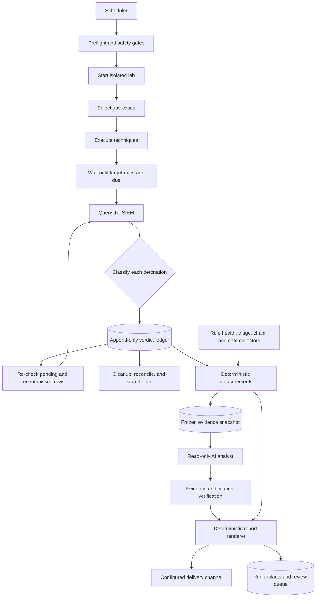

# Zybur Proofloop

**Zybur Proofloop is an open-source, evidence-backed detection-validation harness with an optional AI-analysis integration contract.**

[](LICENSE)
[](pyproject.toml)
[](#project-status)

Zybur Proofloop executes documented attack techniques against Windows hosts in a lab you control,
waits for each detection rule to run, and records whether the expected alert appeared. The resulting
append-only ledger makes silent detection regressions visible before they matter during an incident.

[Quick start](#quick-start-no-lab-required) · [Live lab setup](#run-a-live-validation)
· [Method](docs/method.md) · [Configuration](docs/run.md) · [Extending Proofloop](docs/extend.md)

> [!WARNING]
> Proofloop runs real attack techniques. Use it only on isolated hosts that you own and are
> authorised to test. Never target production systems.

## Why Proofloop?

Attack emulation tools answer _"Can this technique run?"_ Proofloop closes the validation loop by
asking _"Did the rule that should detect it actually fire?"_ It keeps that answer, its timing, and
supporting evidence for every run, making changes in detection coverage measurable over time.

Proofloop is designed for:

- **Detection engineers and SOC teams** that need a repeatable view of which rules still work.
- **Security researchers** who want a reproducible verdict engine and an offline replay workflow.
- **Lab operators** who want deterministic nightly selection, guarded execution, and explicit
  cleanup contracts.

### Key capabilities

- Five sanitised YAML examples covering four ATT&CK tactics, including cleanup, prevention,
  supervised execution, and a deliberately disabled rule.
- Schedule-aware verdicts that distinguish a genuine miss from a rule that has not run yet.
- Evidence correlation by host, rule ID, behaviour time, and non-overlapping detonation windows.
- Deterministic nightly selection that prioritises pending checks, suspected regressions, stale
  proofs, and untested use-cases.
- Safety gates for unattended, supervised, and prohibited techniques.
- An append-only verdict ledger, Markdown reporting, dataset export, and offline replay fixtures.
- An Elastic Security adapter and extension points for additional SIEMs and executors.

## Full operating chain

The verdict engine is the core of a larger validation and reporting loop. A complete deployment can
schedule the run, manage an isolated lab, add bounded AI analysis, and deliver the final report while
keeping measurements and model-generated interpretation separate.



The chain has three deliberate trust boundaries:

- **Measurement is deterministic.** Selection, safety gates, verdicts, counts, latencies, cleanup
  results, and report metrics come from code and recorded evidence, never from a model.
- **AI analysis is advisory.** An optional Codex- or Claude-backed analyst receives a frozen,
  read-only evidence view and may propose explanations or next actions. It cannot execute a
  technique, change a rule, operate the lab, or manufacture a metric. Its evidence references are
  checked before a proposal can enter the report, and disposition remains a human decision.
- **Delivery does not decide content.** The report is rendered before it reaches the configured
  delivery channel. Delivery failures are operational failures, not successful validation runs.

### Attach Codex or Claude as the analyst

The `0.1` engine does not start an AI provider itself. Add a small orchestration adapter after the
deterministic measurements are complete. The adapter contract is provider-neutral:

1. Freeze the ledger rows, rule-health results, triage metrics, and gate outcomes into an immutable
   `evidence.json` snapshot with stable evidence IDs.
2. Invoke Codex or Claude non-interactively with read-only access to that snapshot. For Codex,
   [`codex exec` is intended for bounded scripts and CI jobs](https://developers.openai.com/blog/codex-as-a-platform/#choose-the-right-integration-layer);
   use the Codex SDK or app-server when the surrounding application needs a programmatic or
   persistent session. A Claude adapter should honour the same input and permission boundary.
3. Require structured output containing only `summary`, `findings`, `recommended_actions`, and
   `evidence_ids`. Do not let the model supply verdicts, counts, latencies, or gate results.
4. Reject unknown evidence IDs, then pass the verified proposal and deterministic measurements to
   the renderer. Deliver only the resulting `report.md` through the configured delivery channel.

An orchestration layer can express the boundary like this. This is an integration contract, not a
configuration file parsed by the current engine:

```yaml
analyst:
  provider: codex              # or: claude
  input: artifacts/evidence.json
  output: artifacts/analysis.proposed.json
  filesystem: read_only
  allowed_paths:
    - artifacts/evidence.json
  network: provider_api_only
  timeout_seconds: 180
  may_execute_techniques: false
  may_modify_rules: false
  may_publish: false

report:
  measured_input: artifacts/measurements.json
  analyst_input: artifacts/analysis.verified.json
  output: artifacts/report.md
  delivery: configured_channel
```

Whichever provider you attach, give it an instruction such as: _Analyse only the supplied frozen
evidence; cite every finding by evidence ID; state uncertainty; propose actions; never invent or
change measured facts._ Keep provider credentials in the orchestrator's secret store, outside the
snapshot, prompt, report, and repository.

### What this public release includes

| Layer | Responsibility | Included in `0.1` |
|---|---|---|
| Verdict engine | Select, execute, correlate, classify, re-check, and write the ledger. | Yes |
| Sample use-cases | Demonstrate techniques, expected rules, safety classes, and cleanup contracts. | Five examples |
| Attack report | Render the measured attack table and per-technique details as Markdown. | Yes |
| Operational orchestration | Scheduling, lab power control, broader health collectors, and retention. | Bring your own |
| AI analyst | Produce bounded, evidence-backed proposals from a frozen snapshot. | Deployment layer |
| Delivery | Send the rendered report to a configured delivery channel. | Deployment layer |

This separation keeps the public core reproducible without requiring an AI provider or external
delivery service. It also lets operators attach their own orchestration while preserving the rule
that measured facts and verdicts never come from the AI layer.

### Verdict model

Each use-case defines the technique, target host role, expected rules, safety class, and cleanup
behaviour. The engine executes it, waits for the target rule's schedule, correlates alerts to that
specific detonation, and assigns one of six verdicts:

| Verdict | Meaning |
|---|---|
| `DETECTED` | A target rule fired on the target host inside the use-case's window. |
| `PREVENTED` | No target rule fired, but the endpoint blocked the behaviour in the same window. |
| `MISSED` | The rule was due, the SIEM answered, and no signal explains the absence of an alert. |
| `PENDING` | The rule is not due yet; a later re-check will measure it. |
| `INCONCLUSIVE` | The run cannot be measured reliably, such as when the SIEM did not answer or no rule resolved. |
| `ABORT` | The technique did not execute; the ledger records the executor's reason. |

When multiple signals apply, precedence is
`ABORT > INCONCLUSIVE > DETECTED > PREVENTED > PENDING > MISSED`. A prevention never hides a real
detection, and a run is not marked `MISSED` while another explanation remains.

The classification model follows five principles:

1. **`PENDING` is never `MISSED`.** Proofloop waits until the attack has ended, the rule's schedule
   interval has elapsed, and a two-minute execution allowance has passed.
2. **Prevention uses behaviour time.** A blocked technique becomes `PREVENTED`, not `MISSED`, when
   an Elastic Defend prevention event occurs within the detonation window.
3. **Windows do not overlap.** Each detonation owns alerts until the next detonation begins on that
   host, with a bounded clock-skew tolerance.
4. **Same-host detonations are spaced apart.** A minimum ten-second gap prevents tolerance windows
   from overlapping.
5. **Misses are re-checked.** Late alert ingestion can change a `MISSED` verdict to `DETECTED`.

See [the validation method](docs/method.md) for the complete timing, correlation, precedence, and
staleness model.

## Quick start: no lab required

Replay a scrubbed, recorded validation run to exercise the full verdict path locally. You need
Python 3.11 or later; no Windows host, SIEM, or credentials are required.

```bash
python3 -m venv .venv
source .venv/bin/activate
python -m pip install -r engine/requirements.txt
cd engine
python run.py --replay fixtures/replay/sample-night
```

A successful replay ends with:

```text
replay: 3 of 3 verdicts match expected.json
```

The fixture contains one scrubbed Windows host, three techniques, the alerts returned by the SIEM,
and the expected verdicts. Change a timestamp in `alerts.json` to see how windowing affects the
result.

## Run a live validation

### Prerequisites

- Python 3.11 or later with the dependencies installed as shown in the
  [quick start](#quick-start-no-lab-required).
- An isolated Windows lab host with Elastic Agent and Elastic Defend, reachable over WinRM (HTTP,
  port 5985) from the Proofloop runner.
- An Elastic Security deployment receiving telemetry from that host.
- A read-only Elastic API key with access to `.alerts-security.alerts-*`.
- An export of your enabled Kibana detection rules, saved as `rules_export.ndjson` in the repository
  root. Detection rules are not distributed with this project and retain their original licences.

Additional executors may require a domain controller, CALDERA, SMB tooling, or a dedicated Linux
runner with narrowly scoped `sudo` access. See the [executor reference](docs/run.md#executors) before
enabling them.

### 1. Configure the lab

From the repository root:

```bash
cp lab-hosts.example.json lab-hosts.json
# Edit lab-hosts.json with your lab host name, address, aliases, and Elastic Agent host ID.

export LAB_HOSTS_FILE="$PWD/lab-hosts.json"
export WIN_USER=Administrator
export WIN_PASS='...'
export ES_URL='https://your-deployment.example:443'
export ES_API_KEY='...'
```

All supported variables are listed in [`env.example`](env.example) and documented in the
[configuration reference](docs/run.md#configuration). Keep secrets outside the repository; Proofloop
can also read them from a credentials file specified by `ZYBUR_CREDS_FILE`.

### 2. Bind and validate the rule pack

```bash
cd engine
python genlock.py
python run.py --preflight --executors winrm_command
```

`genlock.py` binds use-case rule names to the stable rule IDs in your Kibana export. The preflight
check prints `preflight ok` when all required settings are present; otherwise, it reports missing
variable names without exposing their values.

### 3. Select, execute, and report

```bash
python run.py --select-nightly 3
python run.py --id USE_CASE_ID --verify --emit-json out.json
python report_md.py out.json
```

Replace `USE_CASE_ID` with an ID returned by `--select-nightly`. Repeat `--id` to run an ordered
batch. Measure unfinished rows later with:

```bash
python run.py --recheck-pending
python run.py --recheck-missed
```

Verification is enabled by default. The registry load fails if an active use-case references a rule
that is not enabled in your export; enable the rule or explicitly mark the use-case as
`expect: not_enabled` or `status: draft`.

A scheduler and lab power management are not included in this release. Use cron, a systemd timer,
or your existing automation; the [scheduling guide](docs/run.md#scheduling) includes a working cron
example.

## Safety model

Every use-case declares how it may be executed:

| Class | Policy | Included |
|---|---|---:|
| `safe` | May run unattended and either cleans up or leaves no persistent state. | 4 samples |
| `supervised` | Requires an operator and the explicit `--allow-supervised` flag. | 1 sample |
| `never` | Documentation only; the runner refuses execution under all flags. | 0 |

`lint.py` enforces this contract. For example, a `safe` use-case that writes to disk must define a
valid cleanup path. Internet-facing techniques require a separate `--allow-internet` gate.

Use a dedicated, isolated lab network and least-privilege credentials. Read [SECURITY.md](SECURITY.md)
for the threat model, credential-handling details, and private vulnerability-reporting process.

## Repository layout

| Path | Purpose |
|---|---|
| `engine/` | Execution, verification, selection, ledger, reporting, SIEM adapters, and tests. |
| [`usecases/`](usecases/) | Five sanitised examples in four ATT&CK tactic directories, plus guidance on keeping an operational catalogue private. |
| `engine/fixtures/replay/sample-night/` | Sanitised replay fixture used by the offline quick start and CI. |
| `docs/method.md` | Verdict semantics, alert windows, due times, re-checks, and proof staleness. |
| `docs/run.md` | Full configuration, command, executor, replay, and scheduling reference. |
| `docs/extend.md` | How to add a use-case, executor, or SIEM adapter. |
| `.github/workflows/ci.yml` | Dependency audit, test suite, use-case lint, and replay checks. |

## Development

Run the same offline checks as CI from `engine/`:

```bash
python -m unittest discover -p 'test_*.py'
python lint.py --no-resolve \
  --export fixtures/rules_export.sample.ndjson \
  --usecases ../usecases \
  --lock ../usecases/_ruleid.lock.json
python run.py --replay fixtures/replay/sample-night
```

See [CONTRIBUTING.md](CONTRIBUTING.md) for contribution requirements and the Developer Certificate
of Origin. Participation is governed by the [Code of Conduct](CODE_OF_CONDUCT.md).

## Project status

Proofloop is currently **alpha software (`0.1.0`)**. Configuration names, integration contracts,
and the ledger format may change before 1.0.

The public repository intentionally contains a small representative sample rather than an
operator's complete rule catalogue, validation history, or known-gap inventory. Bring your own
enabled-rules export and author use-cases for the detections you are permitted to test.

Current priorities include publishing the scrubbed nightly record as a citable dataset, packaging
the optional orchestration and AI-analysis layers for reuse, adding a second SIEM adapter, extending
coverage beyond Elastic's prebuilt Windows rules, and supporting Linux targets. Citation metadata
is available in [CITATION.cff](CITATION.cff).

## License

Zybur Proofloop is available under the [Apache License 2.0](LICENSE). Detection rules imported from
your SIEM are not part of this repository and remain subject to their original licences.

Built and maintained by [Zybur](https://zybur.nl).
